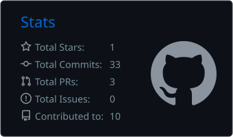
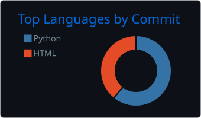

<div align="center">


<br>

<a href="https://www.linkedin.com/in/qandeel-qudsia" target="_blank">
  
</a>
<a href="https://qandeelqudsiaportfolio.netlify.app" target="_blank">
  
</a>
<a href="mailto:qandeelqudsia@gmail.com">
  
</a>

</div>

<br>

## 👩‍💻 About Me

```yaml
Name:        Qandeel Qudsia
Role:        Data Science Student @ PAF-IAST, Pakistan
Focus:       🔭 Data Analytics, Dashboards & Software Development
Learning:    📚 Python, SQL, Power BI, Tableau, JavaScript
Fun Fact:    ⚡ I read books & build small analytical projects for fun
Goal:        🎯 Becoming a Data Scientist at a global tech company
```

- 🔭 Currently building interactive dashboards and data-driven projects
- 📚 Sharpening my skills in SQL and JavaScript
- 🤝 Open to internship opportunities & collaboration
- 💬 Ask me about Power BI, Tableau, or data storytelling

<br>

<div align="center">

## 🛠️ Language & Tools

&nbsp;
&nbsp;
&nbsp;
&nbsp;
&nbsp;
&nbsp;
&nbsp;
&nbsp;

<br><br>


</div>

<br>

## 📊 GitHub Stats

<div align="center">




<br>


<br><br>

<a href="https://github.com/Qandeel2006?tab=followers">
  
</a>
<a href="https://github.com/Qandeel2006?tab=repositories">
  
</a>
<a href="https://github.com/Qandeel2006?tab=stars">
  
</a>

</div>

<br>

## 🚀 Featured Projects

<div align="center">

| 📈 Project | Description | Tools |
|---|---|---|
| **[Sales Performance Dashboard](https://github.com/Qandeel2006/powerbi-dashboard)** | Interactive dashboard analyzing revenue trends, regional performance & KPIs | `Power BI` `DAX` `Power Query` |
| **[HR Analytics Dashboard](https://github.com/Qandeel2006)** | Visualizes employee attrition, department performance & workforce KPIs | `Tableau` `Excel` |
| **[Portfolio Website](https://qandeelqudsiaportfolio.netlify.app)** | Personal portfolio built from scratch | `HTML` `CSS` `JavaScript` |

</div>

<br>

<div align="center">

## 📈 Profile Views


<br><br>

### 💌 Let's Connect

<a href="https://www.linkedin.com/in/qandeel-qudsia" target="_blank">
  
</a>
<a href="mailto:qandeelqudsia@gmail.com" target="_blank">
  
</a>
<a href="https://github.com/Qandeel2006" target="_blank">
  
</a>

<br><br>


</div>
